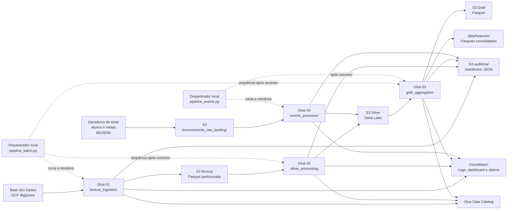

# Pipeline de Dados de Alfabetização — Tech Challenge Fase 2

Pipeline de dados em arquitetura medalhão para ingerir dados públicos do Saeb/Inep, curá-los e publicar indicadores e Feature Stores analíticas. A ingestão e o processamento distribuído são executados no AWS Glue; os dados são armazenados no Amazon S3 em Parquet e Delta Lake.

> **Vídeo executivo (até 5 minutos):** **Pendente** — [inserir aqui o link do vídeo no YouTube](https://www.youtube.com/).

## Sumário

- [Contexto e objetivo](#contexto-e-objetivo)
- [Arquitetura implementada](#arquitetura-implementada)
- [Tecnologias utilizadas](#tecnologias-utilizadas)
- [Decisões arquiteturais e trade-offs](#decisões-arquiteturais-e-trade-offs)
- [Mapa dos artefatos](#mapa-dos-artefatos)
- [Pré-requisitos e configuração](#pré-requisitos-e-configuração)
- [Deploy na AWS](#deploy-na-aws)
- [Execução das pipelines](#execução-das-pipelines)
- [Qualidade, histórico e auditoria](#qualidade-histórico-e-auditoria)
- [Monitoramento e resposta a falhas](#monitoramento-e-resposta-a-falhas)
- [FinOps: medições e projeção](#finops-medições-e-projeção)
- [Aplicação em IA e prevenção de target leakage](#aplicação-em-ia-e-prevenção-de-target-leakage)
- [Limitações conhecidas e próximos passos](#limitações-conhecidas-e-próximos-passos)
- [Evidências e reprodutibilidade](#evidências-e-reprodutibilidade)
- [Documentação complementar](#documentação-complementar)

## Contexto e objetivo

O **Compromisso Nacional Criança Alfabetizada** estabelece o objetivo de garantir a alfabetização das crianças ao final do 2º ano do Ensino Fundamental. O desafio utiliza a avaliação Saeb/Inep e seu indicador de alfabetização; no contexto do projeto, a classificação de alfabetizado considera o ponto de corte de **743 pontos de proficiência**.

A pipeline preserva o indicador `alfabetizado` recebido da fonte para os dados oficiais e usa `peso_aluno` para calcular taxas ponderadas. Ela não reclassifica os microdados oficiais a partir da proficiência. O gerador de eventos sintéticos, por sua vez, simula a regra de 743 pontos para produzir dados de teste.

O projeto publica indicadores por município, UF e Brasil, comparativos com a meta e Feature Stores Parquet. A meta usada nas análises é exclusivamente a **meta pactuada oficial de 80% em 2030**. O compromisso amplo de universalização não é tratado como uma segunda meta numérica de 100% nos comparativos.

## Arquitetura implementada

O diagrama representa os caminhos executados pelo código. O fluxo chamado de “eventos” é **file-based e acionado sob demanda**: os produtores escrevem NDJSON no S3 e o Glue consome os arquivos disponíveis com `availableNow=True`; não há um broker ou serviço de streaming contínuo.



### Fluxo batch

1. `01_bronze_ingestion` consulta metadados das sete entidades do BigQuery e lê pelo conector Spark BigQuery quando detecta uma versão nova ou dados ausentes.
2. `02_silver_processing` lê os prefixos validados pelo manifesto Bronze, aplica padronização, deduplicação, enriquecimentos e joins. O conjunto curado de alunos é Delta Lake em `silver/alunos_curado/`.
3. `03_gold_aggregation` agrega indicadores municipais, de UF e nacionais, constrói comparativos e Feature Stores e registra as tabelas Gold no Glue Data Catalog.
4. O orquestrador baixa e consolida os arquivos Gold em `data/features/` para análise local.

### Fluxo de eventos

1. Os geradores criam **dados sintéticos** e os enviam como arquivos NDJSON para `bronze/events_raw_landing/`; eles não passam pela ingestão batch Bronze.
2. `04_events_processor` valida o contrato e processa arquivos disponíveis com Spark Structured Streaming, checkpoints S3 e `trigger(availableNow=True)`.
3. Eventos de alunos atualizam `silver/alunos_curado/`; eventos de metas são gravados nos destinos Silver próprios de município, UF e Brasil.
4. Após o processador, o orquestrador de eventos executa a Gold e sincroniza os Parquets locais.

**Importante:** a Gold lê `silver/alunos_curado/` e aplica a meta oficial fixa de 80%. Embora o processador persista eventos de metas na Silver, a Gold atual não lê esses três destinos para recalcular os comparativos.

## Tecnologias utilizadas

| Tecnologia | Uso implementado |
|---|---|
| Python e boto3 | Orquestração local, interação com AWS, relatórios e sincronização dos Parquets |
| AWS Glue 4.0 e PySpark | Execução distribuída dos quatro jobs de dados |
| GCP BigQuery e Spark BigQuery Connector | Leitura da fonte pública Base dos Dados |
| Amazon S3 | Landing de eventos, camadas Bronze/Silver/Gold e manifestos |
| Parquet com Snappy | Formato colunar dos datasets Bronze e Gold |
| Delta Lake | Atualizações por chave no conjunto curado de alunos e nos destinos de metas de eventos |
| AWS Glue Data Catalog | Catálogo das tabelas Silver/Gold registradas pelos jobs |
| Amazon CloudWatch | Logs, dashboard e alarmes para métricas de erro dos jobs Glue |
| AWS Secrets Manager | Armazenamento da credencial de serviço do GCP usada pelo Glue |
| pandas, PyArrow, Matplotlib e Seaborn | Leitura local dos Parquets e notebook de análise |
| pytest | Testes automatizados do projeto |

**Não implementado nesta entrega:** serviço broker como Kinesis ou Kafka, processamento always-on, Amazon Redshift, inferência ou treinamento de modelo de Machine Learning, quarentena/DLQ de eventos inválidos, e encaminhamento SNS a partir dos alarmes CloudWatch. São opções de evolução, não componentes do diagrama implementado.

## Decisões arquiteturais e trade-offs

| Tema | Implementação e justificativa | Custo, limite ou alternativa |
|---|---|---|
| BigQuery nativo vs. download manual | O Glue lê o dataset `basedosdados.br_inep_avaliacao_alfabetizacao` pelo Spark BigQuery Connector. A escolha evita gerenciar dumps locais e usa o `modified`, a contagem de linhas e `num_bytes` dos metadados para pular versões sem alteração. | O projeto não registra bytes faturados/escaneados pelo BigQuery nem egress GCP→AWS. `num_bytes` é tamanho de metadados da tabela, não medição de bytes faturados. Consultar faturamento e métricas do projeto GCP para apurar o valor real. Exportar dados para S3 pode reduzir leituras repetidas, mas introduz rotina de replicação e governança. |
| Batch vs. eventos | Batch processa e valida o conjunto Bronze completo/incremental. O caminho de eventos consome arquivos S3 em uma execução sob demanda (`availableNow`), adequada ao teste incremental sem manter workers ativos. | A latência inclui geração, espera pelo acionamento e execução Glue; não é streaming contínuo. Para SLA de segundos ou minutos, avaliar broker e consumidores contínuos, com custo operacional maior. |
| Duplicidade e entrega de eventos | O processamento usa checkpoints e upsert Delta por chave. Duplicatas dentro do micro-lote são reduzidas pelo evento mais recente (desempate por `event_id`); a chave de upsert evita inserir novamente a mesma entidade/ano. A semântica operacional deve ser tratada como **at-least-once**, não como exactly-once ponta a ponta. | Eventos inválidos interrompem o job (`FAILFAST`/validação explícita); não há quarentena nem DLQ. Corrigir/reprocessar os dados e avaliar checkpoints e chaves antes de uma nova tentativa. |
| Data Lake vs. Data Warehouse | S3 é o armazenamento durável em camadas, usando Parquet/Delta; Glue Catalog registra schemas e locais; Athena pode consultar os dados catalogados. | O Glue Catalog não é um Data Warehouse. Um warehouse como Redshift não foi implantado e só deve ser considerado se houver necessidade de workloads SQL concorrentes, baixa latência ou serving analítico dedicado. |
| Bronze e preservação histórica | Bronze é particionada por `ref_ano`, `ref_mes` e `ref_dia`. O Spark usa `partitionOverwriteMode=DYNAMIC`: sobrescreve as partições escritas, preservando as demais. Marcadores `source_versions` evitam reler entidades sem mudança. | A retenção de eventos brutos é diferente: a regra Lifecycle do S3 expira `bronze/events_raw_landing/` após o prazo configurado (padrão 7 dias). |
| Multi-cloud | BigQuery/GCP é a origem publicada já disponível; AWS Glue e S3 são o ambiente de processamento e destino. A chave de serviço GCP é mantida no Secrets Manager para o job. | Exige controlar identidades e faturamento em dois provedores. Custos de BigQuery e transferência entre regiões/nuvens não foram medidos neste projeto. Uma futura migração da origem deve comparar acesso, egress, atualização e operação. |

## Mapa dos artefatos

```text
.
├── README.md
├── .env_example                         # Modelo sem credenciais válidas
├── requirements.txt
├── Makefile
├── data/
│   ├── events_landing/                  # Landing local para testes
│   ├── features/                        # Parquets Gold consolidados localmente
│   └── auditoria/                       # Manifestos de execuções locais
├── docs/
│   ├── ingestion_bronze_layer.md
│   ├── quality_silver_layer.md
│   ├── aggregate_gold_layer.md
│   ├── events_processor.md
│   ├── deploy_aws_setup.md
│   └── evidences/                       # Capturas de telas da AWS
├── notebooks/
│   ├── eda_analytics.ipynb
│   └── notebooks_README.md
├── reports/job_executions/              # Relatórios gerados localmente (ignorado pelo Git)
├── src/
│   ├── common/                          # Regras de qualidade, agregação e manifestos
│   ├── generators/                      # Geradores NDJSON de alunos e metas
│   ├── infra/                           # Deploy e verificações de infraestrutura
│   ├── monitor/                         # Métricas e relatórios
│   ├── scripts/                         # Jobs Glue 01, 02, 03 e 04
│   ├── pipeline_batch.py                # Orquestrador batch
│   └── pipeline_events.py               # Orquestrador de eventos e Gold
└── tests/                               # Testes pytest
```

## Pré-requisitos e configuração

- Python 3.10+ (o ambiente usado para a análise local foi Python 3.12).
- Conta AWS com permissões para S3, Glue, Glue Data Catalog, CloudWatch, Secrets Manager e STS; role que possa ser assumida pelos jobs Glue.
- Credencial de uma conta de serviço GCP com acesso de leitura ao dataset Base dos Dados no BigQuery e faturamento habilitado conforme as regras do GCP.
- Conectividade de rede para AWS, BigQuery e download do Spark BigQuery Connector no deploy.
- Para abrir o notebook: ambiente local com Jupyter/IPykernel, pandas, PyArrow, Matplotlib e Seaborn (incluídos em `requirements.txt`).

### Variáveis e credenciais

1. Autentique-se na AWS pelo mecanismo Boto3/AWS CLI aprovado no seu ambiente (por exemplo, AWS IAM Identity Center/SSO ou profile local). O deploy usa STS para obter a conta ativa; não é necessário colar access keys no README.
2. Copie `.env_example` para `.env`, preencha `AWS_ACCOUNT_ID` com o ID da conta retornado pelo STS e revise as demais configurações.
3. Disponibilize a chave JSON da conta de serviço GCP em um caminho local indicado por `GOOGLE_APPLICATION_CREDENTIALS`. O deploy a lê e grava seu conteúdo no AWS Secrets Manager; não faça commit do arquivo.

O repositório ignora `.env` e `gcp_key.json`/`gcp-key.json`; esses arquivos não fazem parte dos artefatos versionados. O `AWS_ACCOUNT_ID` é necessário porque o orquestrador batch sempre monta o bucket como `<S3_BUCKET_NAME>-<AWS_ACCOUNT_ID>-<AWS_DEFAULT_REGION>`. Use um nome base sem esses sufixos para que deploy e execução apontem para o mesmo bucket; o deploy acrescenta conta e região quando o ID da conta ainda não aparece no nome. Os prefixos padrão (`bronze/`, `silver/`, `gold/`, `auditoria/`) e os nomes dos jobs são convenções do código, não valores totalmente parametrizáveis por ambiente.

```bash
git clone <URL_DO_REPOSITORIO>
cd TECH_CHALLENGE_EDUCACAO

python3 -m venv .venv
source .venv/bin/activate
python -m pip install --upgrade pip
pip install -r requirements.txt

cp .env_example .env
# Edite .env e disponibilize a credencial GCP local no caminho configurado.
aws sts get-caller-identity
```

As variáveis operacionais principais são `AWS_DEFAULT_REGION`, `AWS_ACCOUNT_ID`, `S3_BUCKET_NAME` (nome base), `AWS_GLUE_ROLE_ARN`, `GOOGLE_APPLICATION_CREDENTIALS`, `GCP_BIGQUERY_KEY_SECRET_NAME`, `LIFECYCLE_RULES_EXPIRATION_DAYS`, `JOIN_MATCH_THRESHOLD`, `BLOCK_ON_QUALITY_FAILURE`, `GLUE_POLLING_INTERVAL` e, opcionalmente, as variáveis SMTP para e-mail do orquestrador local.

## Deploy na AWS

> O deploy cria ou atualiza recursos AWS; não é uma simulação nem possui rollback automático. Confira a conta, a região, os nomes e as permissões antes de executá-lo.

```bash
python src/infra/test_connections.py   # Opcional: testar credenciais/conexões
python src/infra/deploy_aws_setup.py
```

O script cria/atualiza o bucket S3, aplica bloqueio de acesso público, SSE-S3 e a Lifecycle Rule da landing de eventos; carrega a credencial GCP no Secrets Manager; envia os scripts/libs e o conector; cria o database Glue `{S3_BUCKET_NAME}_db` e os jobs; e configura dashboard e alarmes CloudWatch. A role Glue e o projeto GCP devem estar previamente autorizados.

Detalhes e comportamento em falhas parciais: [docs/deploy_aws_setup.md](docs/deploy_aws_setup.md).

## Execução das pipelines

### Batch (Bronze → Silver → Gold)

```bash
python src/pipeline_batch.py
```

O processo local dispara os jobs Glue em sequência, consulta seu status e logs e interrompe o fluxo se uma etapa falhar. Ao final, sincroniza os nove datasets Gold para `data/features/`. A primeira execução pode ler as sete entidades no BigQuery; nas execuções seguintes, os marcadores de versão permitem ignorar tabelas inalteradas.

### Eventos e reprocessamento Gold

Os geradores abaixo criam exemplos sintéticos; escolha quantidades pequenas para teste:

```bash
python src/generators/generate_alunos_events.py --quantity 100
python src/generators/generate_metas_events.py --domain municipio --quantity 1
python src/generators/generate_metas_events.py --domain uf --quantity 1
python src/generators/generate_metas_events.py --domain brasil --quantity 1
python src/pipeline_events.py
```

`pipeline_events.py` verifica a landing, executa `04_events_processor`, executa `03_gold_aggregation` após sucesso e sincroniza a Gold. A execução de eventos não aciona o pipeline batch Bronze/Silver. O acesso é controlado pelos checkpoints no S3 e pelos upserts; não apague checkpoints ou dados para “reprocessar do zero” sem planejar o impacto.

### Notebook e testes

```bash
jupyter notebook notebooks/eda_analytics.ipynb
pytest
```

O notebook usa Parquets em `data/features/`. No snapshot atual, 2023 e 2024 são dados oficiais; 2025 e 2026 contêm eventos sintéticos e são identificados separadamente. Consulte [notebooks/notebooks_README.md](notebooks/notebooks_README.md).

## Qualidade, histórico e auditoria

- **Regras informativas:** a Silver registra diagnósticos de schema, nulos, volume e duplicidades das entidades de entrada; duplicidades são tratadas conforme as chaves de negócio configuradas.
- **Trava bloqueante:** o `Match Ratio` mede a proporção de alunos com correspondência na dimensão municipal. O limiar padrão é **95%** (`JOIN_MATCH_THRESHOLD=95.0`); `BLOCK_ON_QUALITY_FAILURE=true` interrompe a execução quando a taxa fica abaixo dele.
- **Indicador Gold:** taxa ponderada `100 × soma(peso_aluno dos alfabetizados) / soma(peso_aluno)`. A validação cruzada municipal é executada quando há taxa publicada compatível; nas execuções recentes, a divergência média observada foi **0,037%**, abaixo da tolerância de **2%**.
- **Meta:** comparativos Gold usam a meta pactuada oficial de **80% em 2030**. Não se aplica meta aspiracional de 100%.
- **Manifestos:** cada job registra status, identificadores, entradas/saídas e métricas em `s3://<bucket>/auditoria/{bronze|silver|gold|events}/.../manifest.json`. O processador de eventos também grava um manifesto de atualização em `auditoria/silver/` para invalidar o skip da Gold.
- **Relatórios locais:** os orquestradores podem gerar Markdown em `reports/job_executions/`. Esse diretório está no `.gitignore`; os relatórios não são automaticamente publicados no repositório.

Consulte [Bronze](docs/ingestion_bronze_layer.md), [Silver e qualidade](docs/quality_silver_layer.md), [Gold](docs/aggregate_gold_layer.md) e [eventos](docs/events_processor.md).

## Monitoramento e resposta a falhas

### “Em produção, quem descobre que a pipeline quebrou, e em quanto tempo?”

- **Com o orquestrador local ativo:** `pipeline_batch.py` e `pipeline_events.py` consultam o estado do job Glue via polling a cada `GLUE_POLLING_INTERVAL` segundos (padrão **10 s**), acompanham CloudWatch Logs e interrompem a sequência em status de falha. Com SMTP configurado, tentam enviar e-mail de falha ao endereço `NOTIFICATION_EMAIL`.
- **Sem o orquestrador local:** os alarmes CloudWatch monitoram `Glue/glue.error.ALL` em períodos de **300 s** com uma avaliação. A equipe identifica o estado `ALARM` no console/dashboard; a configuração atual **não associa SNS nem e-mail aos alarmes**.
- O período do alarme dá uma janela nominal de até 5 minutos após a métrica de erro estar disponível, não um SLA garantido de notificação. Falhas de credencial, execução local/parada do orquestrador ou indisponibilidade SMTP podem impedir a notificação por e-mail.
- A latência calculada nos eventos é `ingested_at - event_time`. No relatório da execução que processou 103 eventos, a latência máxima registrada foi **177,501 s**. É uma medição daquela execução, não uma garantia de latência ponta a ponta para eventos futuros.

Capturas disponíveis: [dashboard](docs/evidences/dashboard_aws_observabilidade.jpg), [alarme](docs/evidences/alarme_cloudwatch.jpg), [jobs Glue](docs/evidences/jobs_aws_glue.jpg), [execuções](docs/evidences/jobs_executions_aws.jpg), [notificação de falha batch](docs/evidences/notificacao_falha_pipeline_batch.jpg) e [notificação de falha de eventos](docs/evidences/notificacao_falha_pipeline_events.jpg).

## FinOps: medições e projeção

As medições abaixo são de execuções reais em AWS Glue, com 2 DPUs G.1X. A estimativa usa o preço unitário de **US$ 0,44/DPU-h** utilizado pelo monitor do projeto; não substitui a fatura AWS. A projeção supõe **30 ciclos batch completos e 30 ciclos de eventos por mês**, com uma execução de cada job listado em cada ciclo.

| Serviço | Unidade | Quantidade medida por execução | Preço unitário usado | Projeção mensal |
|---|---:|---:|---:|---:|
| Glue `01_bronze_ingestion` | DPU-h | 0,0778 | US$ 0,44/DPU-h | US$ 1,03 (30 exec.) |
| Glue `02_silver_processing` | DPU-h | 0,1061 | US$ 0,44/DPU-h | US$ 1,40 (30 exec.) |
| Glue `03_gold_aggregation` — ciclo batch | DPU-h | 0,0967 | US$ 0,44/DPU-h | US$ 1,28 (30 exec.) |
| Glue `04_events_processor` | DPU-h | 0,0944 | US$ 0,44/DPU-h | US$ 1,25 (30 exec.) |
| Glue `03_gold_aggregation` — após eventos | DPU-h | 0,0961 | US$ 0,44/DPU-h | US$ 1,27 (30 exec.) |
| **Total estimado de Glue** | — | **0,4711 DPU-h por ciclo batch + eventos** | — | **US$ 6,22/mês** |
| S3, CloudWatch, Secrets Manager, Glue Catalog | GB-mês, requisições e recursos | **Não medido nesta amostra** | Depende da região/uso | **Não incluído** |
| BigQuery e transferência GCP → AWS | bytes faturados/egress | **Não medidos pelo relatório Glue** | Depende do projeto GCP | **Não incluído** |
| Athena | bytes escaneados | **Não medidos nesta amostra** | Depende da região e volume consultado | **Não incluído** |

Os DPU-h e valores por execução correspondem a relatórios: Bronze `01` (**0,0778 DPU-h; US$ 0,0342**), Silver `02` (**0,1061; US$ 0,0467**), Gold batch `03` (**0,0967; US$ 0,0425**), eventos `04` (**0,0944; US$ 0,0416**) e Gold pós-eventos `03` (**0,0961; US$ 0,0423**). A carga real pode ser menor quando Bronze/Silver são ignoradas por não haver alterações, ou maior conforme tamanho e duração dos jobs.

**Atenção:** metadados `num_bytes` do BigQuery e tamanho da origem não são usados aqui como bytes faturados. Para completar o custo total, consulte AWS Cost Explorer/S3 Storage Lens e faturamento/métricas do BigQuery; a conta também pode ter custos de transferência inter-cloud. A projeção mensal é somente de Glue, sob a frequência assumida.

## Aplicação em IA e prevenção de target leakage

A Gold disponibiliza Feature Stores por município, UF e Brasil e rótulos derivados do alcance da meta oficial de 80%. Elas são uma **base para uma futura Fase 3**; este repositório não implementa treinamento, seleção de modelo ou inferência.

Para prever o alcance futuro da meta:

1. Defina o período alvo e construa `y` (`rotulo_alvo`) exclusivamente a partir do resultado futuro.
2. Separe de `X` o rótulo, a taxa de alfabetização do mesmo período, `gap_para_meta`, o status e qualquer variável calculada com o resultado/meta daquele período.
3. Use features de períodos anteriores ao alvo; aplique separação temporal de treino/validação/teste e valide também por território quando pertinente.
4. Faça a transformação de treino sem usar estatísticas do conjunto de teste.

As tabelas atuais contêm taxa, gap, meta e rótulo juntos por conveniência analítica. Portanto, **não devem ser entregues diretamente a um modelo como matriz `X`** sem uma seleção temporal de features e um teste explícito de vazamento.

## Limitações conhecidas e próximos passos

- Os eventos de alunos/metas são sintéticos e voltados a validar o mecanismo. Eles não representam resultados oficiais nem atualização oficial das metas; no snapshot analisado, 2025 e 2026 contêm registros de teste.
- O consumidor é acionado sob demanda sobre arquivos no S3; não há mensageria contínua, SLA de baixa latência ou escalonamento automático de consumidores.
- Eventos inválidos fazem a execução falhar; ainda não há DLQ/quarentena e rotina de reenvio seletivo.
- Os eventos de metas são armazenados em destinos próprios da Silver, mas a Gold ainda não os consome; os comparativos usam 80% fixos.
- A leitura de fonte oficial é via BigQuery. Bytes escaneados, custo/egress GCP e atualização automática quando a fonte oficial muda precisam ser acompanhados no faturamento da origem.
- Alarmes CloudWatch não enviam SNS/e-mail. A notificação por SMTP pertence ao orquestrador local e depende de ele estar ativo e configurado.
- A camada Silver possui o conjunto curado de alunos registrado no catálogo. A criação/catálogo dos destinos Silver de metas por evento ainda deve ser verificada/implementada; não assumir que esses destinos sejam tabelas Glue catalogadas.
- A Feature Store não é um pipeline de ML completo nem impõe sozinha prevenção de target leakage.

## Evidências e reprodutibilidade

### Snapshot de execução AWS

Os identificadores abaixo permitem localizar as execuções no AWS Glue. Custos de Glue são estimativas baseadas em DPU-h do relatório; contagens Gold/Silver são do relatório e, para as quatro tabelas principais, foram conferidas em `COUNT(*)` no catálogo pelo usuário.

| Job | Run ID | Resultado observado |
|---|---|---|
| `01_bronze_ingestion` | `jr_93d03c617a1d58f7f495ad4db9032ece3cf7b362cbe0093f041e67557a797d44` | `SUCCEEDED`; 3.867.999 alunos nos metadados da origem |
| `02_silver_processing` | `jr_2fdf42280493ad2b8a5b6d690010b93c0606c604894b4a3f5ec6c7d872c4ee17` | `SUCCEEDED`; carga inicial curada |
| `04_events_processor` | `jr_7b322e417fc2b4a3e93d7fa6661f72ae8379acc93436a2441054dd66bc1c8a8f` | `SUCCEEDED`; 100 eventos de alunos + 3 eventos de metas |
| `03_gold_aggregation` pós-eventos | `jr_107a78d671a202995528b53cd1d93849cf3de24b362d453ff6cab21ee2d81397` | `SUCCEEDED`; 3.868.099 linhas Silver lidas; divergência média 0,037% |

| Tabela consultada | `COUNT(*)` |
|---|---:|
| `silver_alunos_curado` | 3.868.099 |
| `gold_indicadores_municipais` | 12.469 |
| `gold_desempenho_vs_metas` | 10.295 |
| `gold_features_alfabetizacao` | 10.295 |

Na mesma execução Gold, o relatório registrou `gold_indicadores_uf=145`, `gold_indicadores_brasil=9`, 89 linhas de comparativo/Feature Store UF e 4 linhas de comparativo/Feature Store Brasil. As tabelas e artefatos foram atualizados às **2026-11-03 UTC**.

Os manifestos correspondentes ficam no bucket configurado nos prefixos `auditoria/bronze/`, `auditoria/silver/`, `auditoria/events/` e `auditoria/gold/`, organizados por `ingestion_date` e `run_id`. Os relatórios Markdown locais são emitidos em `reports/job_executions/`, mas o diretório é ignorado pelo Git; mantenha os IDs e evidências publicados ou registre os relatórios em armazenamento apropriado para auditoria durável.

Capturas de evidência: [bucket S3](docs/evidences/buckets_s3.jpg), [jobs Glue](docs/evidences/jobs_aws_glue.jpg), [execuções](docs/evidences/jobs_executions_aws.jpg), [atualização Silver](docs/evidences/atualizacoes_silver_alunos_curado.jpg) e [dashboard](docs/evidences/dashboard_aws_observabilidade.jpg).

Para reproduzir em uma conta de teste:

1. Clone o repositório, instale os requisitos e configure `.env`, credenciais AWS e credencial GCP conforme [Pré-requisitos e configuração](#pré-requisitos-e-configuração).
2. Revise bucket, região, role, Secret e permissões; execute `python src/infra/deploy_aws_setup.py`.
3. Execute `python src/pipeline_batch.py`; confira status dos jobs, logs, manifestos e tabelas Silver/Gold no catálogo.
4. Gere lotes pequenos e identificáveis com os scripts em `src/generators/`; execute `python src/pipeline_events.py`.
5. Compare `COUNT(*)`, schemas e amostras das tabelas catalogadas com os relatórios/manifestos; use `data/features/` e o notebook para validações locais.

As contagens deste README são um snapshot e podem mudar após novas cargas/eventos; para um ambiente recém-criado, o resultado depende das versões atuais da fonte e das configurações da conta.

## Documentação complementar

- [Ingestão Bronze](docs/ingestion_bronze_layer.md)
- [Qualidade e processamento Silver](docs/quality_silver_layer.md)
- [Agregação Gold](docs/aggregate_gold_layer.md)
- [Processador de eventos](docs/events_processor.md)
- [Deploy AWS](docs/deploy_aws_setup.md)
- [Notebook de análise](notebooks/notebooks_README.md)
